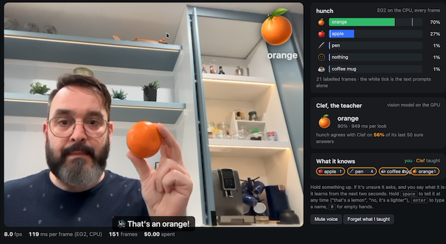

# objects: a webcam that names things and learns new ones

A `hunch.live` demo. Hold something up to the camera, and it says out loud what it is. It knows about forty everyday
things from text prompts alone. If it is not sure, it asks you. You tell it ("that's a seashell"). It then learns the
new thing from the next two seconds of frames. If you add a teacher (Clef), the teacher also labels the frames it is
confident about. The teacher keeps checking the student's answers until each thing graduates.



From `examples/`, after the [setup](../README.md#setup):

```bash
uv run --with faster-whisper --with kokoro-onnx objects/objects.py      # then open http://localhost:8766 in Chrome
```

Press Start and allow the camera and microphone. To talk, hold <kbd>space</kbd> ("that's a lemon"). To type a name,
press <kbd>Enter</kbd>. To show it your empty hands again, hold <kbd>0</kbd>.

**Needs:** EmbeddingGemma 2 (see [Setup](../README.md#setup)), a webcam and a microphone, and a browser on the same
machine: browsers allow the camera on `http://localhost` but not on other plain-HTTP addresses. **Time:** the server
is ready in about 30 s; a frame takes about 110 ms on an Apple M5 Pro's CPU.

**Downloads on first use:** Kokoro's voice (90 MB, to `~/.cache/hunch/kokoro`) when the server starts. Whisper's
`small.en` downloads the first time you speak. The voices of the browser speak instead if `kokoro-onnx` is absent, if
you use `--voice browser`, or if Kokoro cannot speak on the machine.

**Options:** `--port` (default 8766), `--tokens 140` (smaller things, about half the frame rate), `--voice` (a Kokoro
voice, or `browser`) and `--teacher` (Clef, below).

## Without a camera

To check that the server works, send it any image. It answers with the thing it sees:

```bash
curl -s --data-binary @../docs/demo/objects.png localhost:8766/frame
```

## A teacher

```bash
OPENROUTER_API_KEY=... uv run --with faster-whisper --with kokoro-onnx objects/objects.py --teacher openrouter:cloudflare/clef-flash
uv run --with faster-whisper --with kokoro-onnx --with "mlx-vlm>=0.7.4,<0.8" --with pillow \
    objects/objects.py --teacher path/to/clef-flash-4bit          # a local Clef on Apple silicon
```

While something has not graduated, Clef looks at a frame about once a second. After it has graduated, Clef looks at
random moments (every 10 s on average). A thing graduates after about 35 steady answers that Clef agrees with. The
bar under its name shows how far it is. Through OpenRouter, a look costs about $0.00001.

## What it keeps

Labelled frames go in `objects/frames/` (git-ignored). They are each JPEG, its embedding and `labels.jsonl`. The
server teaches them again when it starts. "Forget what I taught" sets the labels aside as `labels.<time>.jsonl`. The
frames are pictures of you and your room. They stay on your machine.

`objects.py`'s docstring has how it answers, step by step.
